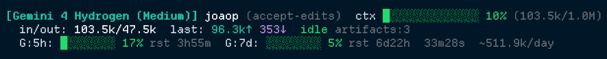
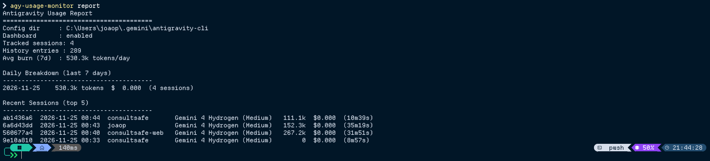

# agy-usage-monitor

Real-time usage dashboard for [Antigravity CLI (`agy`)](https://antigravity.google/docs/cli/statusline) in the terminal status line, inspired by `claude-usage-monitor`.

<div align="center">



</div>

## Features

- **Zero external dependencies** (pure Python 3.8+ standard library)
- **Context window meter** with color-coded progress bar and `[HIGH]` (75%) / `[CRIT]` (90%) badges
- **Token & cache breakdown** (session totals, last turn input/output, cache read/creation)
- **Quota buckets & reset countdown** (5h / 7d / custom buckets from `agy` statusLine payload)
- **Estimated cost, session duration & 7-day burn rate** tracked locally in `~/.gemini/antigravity-cli/agy-usage-stats.json`
- **Safe installer & uninstaller** with automatic backup of `~/.gemini/antigravity-cli/settings.json`
- **Antigravity skills** (`agy-usage` and `agy-dashboard`) for detailed reports and toggling the dashboard

## Install

### From GitHub

```powershell
git clone https://github.com/masteryogo/agy-usage-monitor.git
cd agy-usage-monitor
python install.py
```

### Via `uv` / `pip` (from GitHub)

```powershell
uv tool install git+https://github.com/masteryogo/agy-usage-monitor.git
agy-usage-monitor install
```

Restart `agy` (or run `/statusline enable` inside `agy`).

### Manage / Uninstall

```powershell
python install.py status
python install.py disable
python install.py enable
python install.py uninstall
```

### Usage Report

```powershell
agy-usage-monitor report --days 7
```

<div align="center">



</div>
